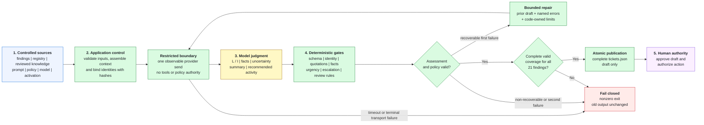

# Inspection Finding Triage — System Design

## Executive summary

The system converts a fixed snapshot of inspection findings, equipment data and
reviewed domain guidance into a complete batch of maintenance-planning drafts.
Its main design decision is an explicit separation of judgment and control:

- the model interprets free text and proposes likelihood, impact, fact states,
  uncertainty, a summary and a recommended activity;
- deterministic code owns identity, schema, evidence checks, urgency,
  escalation, review routing, attempts, coverage and publication; and
- a human owns approval and operational action.

This boundary follows the Candidate Brief rather than treating an LLM response
as the product. A fluent but unsupported answer is not allowed to become a
ticket merely because it is valid JSON.

The four engineering traps that shaped the design are:

1. missing evidence is unknown, not confirmed absence;
2. redundancy is a claim until partner availability and capability are shown;
3. SCE impact concerns the protected major-accident scenario, not repair cost;
4. structural validity and engineering validity are different gates.

The supporting decision trail is in [`docs\README.md`](docs/README.md).

## Architecture and responsibility boundary



The diagram is intentionally asymmetric: the model contributes engineering
judgment, but it cannot select runtime knowledge, derive urgency, spend retries,
publish a partial batch or authorize work. Those authorities remain with
reviewable code and the human approver.

| Model interprets or authors | Deterministic code owns |
|---|---|
| Meaning of findings and engineer comments | Input shape, IDs, joins, dates and score direction |
| Near-term likelihood and consequence | Closed schemas, ranges and text limits |
| Confirmed, false, suspected and unknown facts | Citation existence, exact quotations and fact consistency |
| Material uncertainty and proposed checks | Urgency arithmetic, floors and review rules |
| Summary and recommended activity | Attempt budget, complete coverage and atomic publication |
| Explicit inability to support L/I | Nonzero failure; never a guessed fallback score |

Three modules keep authority separate:

- `triage_knowledge` owns source ingestion, provenance, review, immutable
  release, activation inputs and context validation;
- `llm_inference` exposes restricted provider calls without owning engineering
  policy; and
- `triage` owns assessment orchestration, validation, urgency, attempts and
  publication.

The dependency is one-way: triage consumes a pinned knowledge contract.
Knowledge tooling cannot publish tickets or choose urgency, and provider
adapters cannot redefine triage policy.

Detailed component decisions are recorded in
[`04_INFERENCE_LIBRARY.md`](docs/04_INFERENCE_LIBRARY.md),
[`05_KNOWLEDGE_LIFECYCLE.md`](docs/05_KNOWLEDGE_LIFECYCLE.md) and
[`06_TRIAGE_WORKFLOW.md`](docs/06_TRIAGE_WORKFLOW.md).

## A. Structured output and failure behavior

> **Candidate Brief §6.A.** How is output conformance enforced; what happens
> after a malformed response, a structural violation or a valid-but-incorrect
> score; and what is the failure mode when a ticket cannot be produced?

The model returns an internal assessment object rather than the final public
ticket. Code then projects the validated assessment into the required ticket
schema.

The assessment parser rejects:

- malformed JSON and duplicate keys;
- extra or missing fields, wrong identity and invalid score types/ranges;
- unsupported citations or quotations that do not match supplied evidence;
- inconsistent fact states and missing verification activities; and
- text or planning output that violates the declared contract.

### Recovery policy

| Failure | System behavior |
|---|---|
| Malformed response | One bounded repair with the same pinned context and a concise parser diagnostic |
| Structural or evidence violation | One bounded repair with the rejected draft and named contract errors |
| Deterministically contradictory score/fact | One bounded repair when code can prove the contradiction |
| Coherent but engineering-wrong score | Schema code cannot prove it wrong; it remains subject to semantic and human review |
| Unsupported or unassessable L/I | Terminal batch failure; no midpoint or placeholder score |
| Both attempts invalid | Nonzero exit; no new publication |

One repair was chosen because observed malformed/schema-invalid responses were
sometimes corrected by explicit feedback, while additional retries would raise
cost and create optional stopping. The total batch attempt budget is persisted
for one run, so restarting that run cannot refund spent attempts. A new
operator-authorized invocation creates a new ledger and budget.

The final wrapper is validated for exact input coverage. Publication uses a
same-volume temporary file and atomic replacement. If any finding fails, the
batch is incomplete or replacement fails, the previous `tickets.json` remains
unchanged. Partial publication was rejected because it can conceal a missing
finding inside an apparently successful planning package.

The system can validate evidence use and internal consistency; it cannot certify
that a plausible L/I judgment is engineering truth. That is why deterministic
validation, separate semantic review and human approval remain distinct.

## B. Domain knowledge and maintainability

> **Candidate Brief §6.B.** How do `domain_knowledge.md` and the registry
> `engineer_comment` reach the model, why is that mechanism used, and what does
> an integrity engineer modify to change how PSV findings are scored?

Every assessment receives:

- the selected finding and its inspection metadata;
- the complete bounded equipment registry, including `engineer_comment`;
- deterministic same-equipment and declared relationship evidence;
- reviewed, source-faithful domain items from the active immutable release; and
- prompt, policy, selector, release and input identities.

The supplied `reference\domain_knowledge.md` bytes are preserved, extracted into
source-linked items, explicitly reviewed, published in an immutable release and
delivered in the hash-bound provider context. `engineer_comment` reaches the
same request through the validated registry snapshot rather than through the
maintained knowledge release.

Production context excludes evaluation cards, expected answers and reviewer
judgments. The workflow independently rebuilds and validates the expected
context before provider dispatch.

Complete bounded context was chosen over vector RAG because the supplied corpus
contains only 21 findings and 18 assets, while relationships can change the
decision. This avoids ranking and omission failure modes at the cost of more
input tokens. If the corpus grows materially, measured retrieval quality and
safe context reduction would be required before changing this choice.

### Six months later: changing PSV behavior

The correct edit surface depends on what changed:

| Requested change | Owner and change surface |
|---|---|
| New approved PSV evidence or interpretation inside the existing rubric | Domain owner adds/replaces an approved source; a knowledge steward imports, reviews and publishes a new immutable release; a runtime approver activates it |
| A new fact about one valve | Asset-data owner supplies a new registry snapshot |
| A generic likelihood/impact anchor | Application-policy owner changes `triage\assessment_policy.py` and focused tests; a runtime approver issues a new reviewed activation |
| An urgency threshold or exceptional-review rule | Application-policy owner changes `triage\policy.py` and focused tests; a runtime approver issues a new reviewed activation |
| Extraction or selector behavior | Knowledge-tooling owner changes `triage_knowledge`, reruns the component evaluation and issues a new reviewed activation |

Knowledge publication and activation are separate decisions. Saving or
publishing technically valid source material does not automatically give it
runtime authority. A change that overlaps interpretation still embedded in the
prompt requires compatibility review before activation.

This path was exercised in a controlled study. It demonstrated visible,
bounded influence, exposed a scope/provenance defect and non-target variance,
and ended with a decision not to promote the experimental PSV rule. That is the
intended maintenance property: changes are observable, reviewable and
reversible; output movement alone is not proof that a new rule is correct.

See [`05_KNOWLEDGE_LIFECYCLE.md`](docs/05_KNOWLEDGE_LIFECYCLE.md) for the
production interface and
[`07_KNOWLEDGE_CHANGE_STUDY.md`](docs/07_KNOWLEDGE_CHANGE_STUDY.md) for the
observed experiment.

## C. Urgency derivation

> **Candidate Brief §6.C.** What function derives urgency, how does it behave
> for high likelihood with low impact and low likelihood with high impact,
> which overrides apply, and why was this approach chosen over alternatives?

The model never outputs urgency. For ordinal likelihood `L` and impact `I`, code
computes:

```text
base  = ceil(0.7 * I + 0.3 * L)
      = (7 * I + 3 * L + 9) // 10
final = max(base, every applicable rule floor)
```

The supplied notes require asymmetric corners: low-likelihood/high-impact SCE
findings still need prompt attention, while near-certain low-consequence failure
may wait for shutdown. A normalized weighted form
`ceil(w*I + (1-w)*L)` satisfies the stated corner bands when
`2/3 <= w <= 7/9`. `w=0.7` is a simple interior value with exact integer
arithmetic. It is a declared prototype policy, not an empirically calibrated
risk model.

| L / I | Plain mean | Plain maximum | Chosen base | Behavior |
|---|---:|---:|---:|---|
| 1 / 1 | 1 | 1 | 1 | Low/low remains low |
| 10 / 1 | 5.5 | 10 | 4 | High likelihood does not erase low consequence |
| 1 / 10 | 5.5 | 10 | 8 | High consequence still receives prompt attention |
| 10 / 10 | 10 | 10 | 10 | High/high reaches the ceiling |

All 100 L/I pairs are range-checked and monotone. These checks establish formula
behavior, not operational calibration.

### Overrides and policy floors

The two supplied overrides apply only when their required facts are confirmed:

| Rule | Trigger | Effect |
|---|---|---:|
| Protection override | Confirmed protection impairment and confirmed absence of a recorded deviation | Floor 9 |
| Evacuation override | Confirmed available evacuation capacity below POB | Floor 9 |

Missing deviation, restoration, POB or partner evidence cannot be converted into
a confirmed override. Separately labelled candidate policies provide
precautionary floors or focused review when safety-relevant state is material
but unresolved—for example, a confirmed failed protection-function test,
unverified evacuation capacity, unverified restoration, or an SCE assessed at
high impact.

A plain mean was rejected because it understates the low-L/high-I corner. A
plain maximum was rejected because it overstates high-L/low-I findings. Asking
the model for urgency was rejected because it violates the brief and hides
arithmetic and rule provenance.

The complete rule set and calibration history are in
[`06_TRIAGE_WORKFLOW.md`](docs/06_TRIAGE_WORKFLOW.md) and
[`08_BEHAVIOR_CALIBRATION_STUDY.md`](docs/08_BEHAVIOR_CALIBRATION_STUDY.md).

## D. Deferral, limits and rejected scope

> **Candidate Brief §6.D.** How does the system decide to defer to a human
> instead of answering, and what was deliberately not built?

The system has three valid outcomes:

1. a supported draft;
2. a supported draft with a specific verification activity and, where material,
   exceptional prequeue review; or
3. terminal inability to produce the complete batch.

`review_required` identifies a specific unresolved decision before work-queue
entry. It does not replace the ordinary human approval required for every draft.
No output authorizes maintenance, shutdown or work-order creation.

The system fails rather than guesses when required scores cannot be justified,
authority conflicts cannot be resolved, evidence quotations are unsupported,
or the attempt budget is exhausted.

The following alternatives were deliberately not built:

| Alternative | Reason rejected |
|---|---|
| Model-authored urgency | Conflicts with the brief and obscures deterministic provenance |
| Rules-only L/I | Brittle for interacting free-text evidence and likely to encode case-specific answers |
| Placeholder/midpoint scores | Converts inability into false completeness |
| Automatic redundancy credit | A registry label does not prove current partner health |
| Code rewriting semantic prose | Can manufacture plausibility without new evidence |
| Vector RAG or autonomous web retrieval | Adds ranking, omission and authority risks without need at this corpus size |
| Unbounded retries or partial publication | Raises cost and can hide unstable or missing findings |
| Automatic operational action | Outside the brief; every result remains a human-approved draft |

The production core is intentionally smaller than the evaluation apparatus.
Frozen cards, semantic reviewers, archives and experiment ledgers establish
evidence for the prototype; they are not runtime dependencies of ticket
generation.

## E. Reproducibility and delivery identity

> **Candidate Brief §5 constraint.** The system must run end to end from one
> documented command. How can another engineer execute it, and what identifies
> the exact inputs, configuration and output of a run?

The root `README.md` documents one command for each supported provider:

```powershell
.\.venv\Scripts\python.exe -B run_triage.py --provider copilot
.\.venv\Scripts\python.exe -B run_triage.py `
  --provider azure --model "<deployment-name>"
```

The wrapper creates fresh configuration, evidence and attempt-ledger paths,
then invokes the same production `triage` CLI used by the retained runs. A run
binds:

- exact finding and registry hashes;
- knowledge release and activation identity;
- prompt, assessment-policy, urgency-policy and projection identity;
- provider route, model, reasoning setting and assessment time;
- application sends, errors, exposed token usage and latency; and
- publication receipt and final output SHA-256.

The input package remains byte-preserved, direct dependencies are pinned, the
activation is committed and successful publication is atomic. Deterministic
tests cover wrapper configuration, activation compatibility, failure paths and
the production workflow. Model output is not expected to be byte-identical
between runs; reproducibility means that the same declared system can be
identified, executed and audited without silently changing its inputs or
policy.

The submitted root artifact was produced by the retained reviewed delivery and
promoted byte-identically. The current workflow was also replayed
contract-valid across all 21 findings using the same `triage` CLI, source and
retained activation in `copilot_experiment` mode; that replay was not
semantically reviewed. Its execution-policy identity differs from the delivery
run because the current workflow adds documented post-publication rollback.
The observation was recorded from a dirty worktree. The `run_triage.py` wrapper
has deterministic coverage, while live invocations record distinct evidence
because provider output can vary. Clean-checkout reproduction remains an
explicit open gate rather than a claimed pass.

## F. Cost and run budget

> **Candidate Brief §5 constraint.** A full run must remain inexpensive enough
> to reproduce. How is application spend bounded, what was actually measured,
> and which cost values remain unknown?

Application work is bounded structurally even though provider-level cost is
only partially observable:

- one assessment request is prepared per finding;
- malformed or structurally invalid output receives at most one application
  repair;
- the persistent ledger prevents a restarted run from refunding spent
  attempts;
- partial success is not published; and
- the small fixed corpus uses complete bounded context instead of additional
  retrieval infrastructure.

The application ceiling is 42 sends: at most two for each of 21 findings. This
is not a provider-attempt or USD ceiling because Copilot can hide transport
attempts and repair payloads may be larger than first attempts. The retained
delivery needed no repairs: it used 21 application sends, 973,468 input tokens
and 40,335 output tokens. Applying the declared public short-context rates of
US$2 per million input tokens and US$10 per million output tokens gives:

```text
(973,468 * US$2 + 40,335 * US$10) / 1,000,000
= US$2.350286
```

That is a reproducible API-equivalent estimate, about US$0.111918 per ticket,
not a Copilot invoice. Applying the separately declared cache-read and
30-minute cache-write assumptions gives a higher US$2.493186 scenario. The
receipt reports 21 request-cost units and 249.31861 AI units. Copilot does not
expose the subscription's per-run USD allocation, its AI-unit-to-USD conversion
or hidden HTTP attempts, so those values remain unknown.

Input represents about 82.8% of the simple estimate. Complete context was still
chosen for this small corpus because relationship omissions were a larger
prototype risk than the measured cost. If the corpus grows, safe context
reduction is the first cost optimization to evaluate; it must demonstrate
retrieval coverage before replacing complete context.

Exact usage, source-run hash, rates and calculation are retained in
[`delivery-cost-summary.json`](eval/results/delivery-cost-summary.json).
Provider and cache-aware cost boundaries are detailed in
[`04_INFERENCE_LIBRARY.md`](docs/04_INFERENCE_LIBRARY.md).

## Assumptions

| Assumption | Consequence or safeguard |
|---|---|
| The supplied files are the complete selected snapshot | The system does not invent later repair, deterioration or operating state |
| The assessment cutoff is fixed at `2026-07-01T00:00:00+00:00` | Evidence is interpreted as of one declared time |
| Registry comments are evidence, not conclusions | They must be interpreted and grounded like finding text |
| Missing records remain unknown | Confirmed overrides cannot be inferred from silence |
| Redundancy labels do not establish availability/capability | Partner evidence is checked before credit is applied |
| Reliability and criticality are directed priors | They inform but never replace finding-specific L/I judgment |
| SCE consequence is judged against the protected scenario | Repair cost is not the impact definition |
| L/I/U are ordinal scales | Numeric gaps are not treated as calibrated probabilities or equal intervals |
| One bounded repair is an acceptable cost/recovery trade-off | Further retries require new evidence |
| The small corpus justifies complete bounded context | Retrieval infrastructure is deferred until scale creates a demonstrated need |
| A trusted local writer can perform same-volume atomic replacement | No distributed-concurrency guarantee is claimed |
| Every generated ticket is a draft | Human approval remains mandatory |

## Evidence status and known limitations

The final artifact covers all 21 findings and passes the deterministic output
contract. It was generated by the retained reviewed delivery and promoted
byte-identically. Retained real-model runs show that malformed JSON, schema
violations and exhausted responses occur in practice; the controls made those
outcomes bounded and fail-closed. The final development repeat preserved
urgency bands and exceptional review routing, but full stability acceptance
remains inconclusive because the reviewer runtime did not expose every required
identity.

The current evidence does not establish independent domain certification,
population-level model reliability, per-finding knowledge isolation or
byte-identical replay of model output. Numeric urgency thresholds and candidate
precautionary floors require domain-owner calibration before operational use.

Observed results and exact limitations are indexed in
[`eval\results\README.md`](eval/results/README.md). The acceptance contract and
claim boundaries are explained in
[`03_EVALUATION_ACCEPTANCE.md`](docs/03_EVALUATION_ACCEPTANCE.md).

## AI assistance, accountability and compliance

I developed this system end to end in this repository with GitHub Copilot CLI
as an AI coding assistant. Copilot helped explore architecture alternatives,
implement code and tests, draft documentation, run experiments and critique
changes. I made the final architecture and engineering decisions, directed and
reviewed the AI output, resolved conflicting suggestions and remain accountable
for everything submitted.

I overrode or rejected AI proposals where they weakened the design:

- urgency remains code-derived and is never model-scored;
- per-finding answer tables, placeholder scores and silent fallbacks were
  rejected;
- redundancy is not credited without partner evidence;
- failed and inconclusive observations are retained rather than rerun until
  green;
- evaluation answers remain outside production context; and
- test-informed changes are disclosed instead of presented as blind evidence.

Two concrete examples are retained for review: the prompt-only chronology
repair was rejected after it changed development routing
([Document 08](docs/08_BEHAVIOR_CALIBRATION_STUDY.md)), and an experimental PSV
knowledge release was not promoted after the study exposed authority, scope and
non-target risks
([Document 07](docs/07_KNOWLEDGE_CHANGE_STUDY.md)).

No other candidate's solution or copied implementation was used.

The repository follows the Candidate Brief restrictions:

- no LangChain, LangGraph, LlamaIndex, CrewAI, AutoGen, Haystack, Semantic
  Kernel, DSPy, Pydantic AI or equivalent orchestration framework is present;
- orchestration, structured-output validation, repair, urgency and publication
  are implemented in this repository;
- `github-copilot-sdk` is restricted to bare inference: the adapter replaces
  the system message and disables tools, MCP servers, skills, custom
  instructions, host operations and framework discovery;
- the Azure/OpenAI SDK-only route is available through the same
  provider-neutral inference boundary;
- no API key is committed; and
- `tickets.json` is generated by the system, not hand-authored or corrected.

Provider setup and the one-command end-to-end run through `run_triage.py` are documented in
[`README.md`](README.md).
