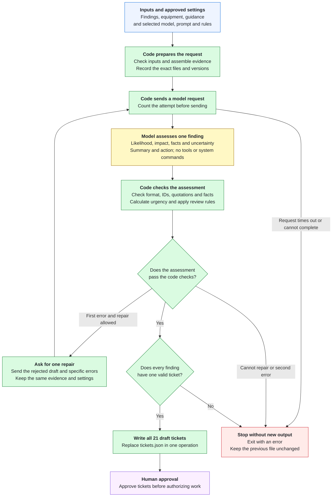

# Inspection Finding Triage — System Design

## Executive summary

The system reads inspection findings, equipment records and reviewed engineering
guidance. It produces a complete set of draft maintenance tickets.
The model, code and human have different responsibilities:

- the model interprets free text and proposes likelihood, impact, fact states,
  uncertainty, a summary and a recommended activity;
- code checks IDs, the JSON structure and evidence. It calculates urgency,
  decides which tickets need extra review, limits attempts and writes the
  complete output; and
- a human approves the drafts and authorizes any operational action.

The model's answer is not the finished product. Code must check it first.
An answer can be readable and valid JSON but still lack supporting evidence.
Valid JSON alone is not enough to accept a ticket.

In this document, **L** means likelihood of failure soon, **I** means the impact
if failure occurs, and **U** means urgency: how soon a human must act. Each uses
a 1-10 scale. A **Safety Critical Element (SCE)** protects against a major
accident. A **pressure safety valve (PSV)** is one type of protective equipment.

The four engineering traps that shaped the design are:

1. missing evidence is unknown, not confirmed absence;
2. redundancy is a claim until partner availability and capability are shown;
3. SCE impact concerns the protected major-accident scenario, not repair cost;
4. correct JSON structure does not prove a correct engineering judgment.

The supporting decision trail is in [`docs\README.md`](docs/README.md).
Sections A-D answer the Candidate Brief's four design questions. Sections E-F
explain how to repeat a run and how cost is reported.

## Architecture and responsibility boundary



The model proposes engineering judgments. It cannot choose the active knowledge,
calculate urgency, grant itself more attempts, write a partial batch or
authorize work. Code controls the run; a human controls approval.

| Model proposes | Code controls |
|---|---|
| Meaning of findings and engineer comments | Input format, IDs, equipment links, dates and score direction |
| Near-term likelihood and consequence | Required fields, allowed fields, score ranges and text limits |
| Confirmed, false, suspected and unknown facts | Source references, exact quotations and consistency between facts |
| Uncertainty that can change a decision, and proposed checks | Urgency calculation, minimum urgency rules and review rules |
| Summary and recommended activity | Attempt limits, one ticket per finding and complete output replacement |
| A statement that L/I cannot be supported | Stop with a nonzero exit code; never substitute a guessed score |

Three modules keep these responsibilities separate:

- `triage_knowledge` imports and reviews sources, records where each item came
  from, creates fixed releases and checks the knowledge sent to the model;
- `llm_inference` sends restricted provider requests. It does not define
  engineering policy; and
- `triage` coordinates assessment, checks responses, calculates urgency,
  counts attempts and writes output.

`triage` uses one selected knowledge version. The knowledge tools cannot write
tickets or choose urgency. The provider adapters cannot change triage policy.

Detailed component decisions are recorded in
[`04_INFERENCE_LIBRARY.md`](docs/04_INFERENCE_LIBRARY.md),
[`05_KNOWLEDGE_LIFECYCLE.md`](docs/05_KNOWLEDGE_LIFECYCLE.md) and
[`06_TRIAGE_WORKFLOW.md`](docs/06_TRIAGE_WORKFLOW.md).

## A. Structured output and failure behavior

> **Candidate Brief §6.A.** How is output conformance enforced; what happens
> after a malformed response, a structural violation or a valid-but-incorrect
> score; and what is the failure mode when a ticket cannot be produced?

The model returns an internal assessment, not the final ticket. Code checks the
assessment and converts it into the required ticket format.

The assessment parser rejects:

- malformed JSON and duplicate keys;
- extra or missing fields, wrong IDs and invalid score types or ranges;
- unsupported citations or quotations that do not match supplied evidence;
- inconsistent fact states and missing verification activities; and
- text or actions that violate the declared requirements.

### Recovery policy

| Failure | System behavior |
|---|---|
| Malformed response | Ask the model to repair it once, using the same context and a specific parsing error |
| Invalid structure or evidence | Ask for one repair, including the rejected draft and specific errors |
| Score or fact that contradicts a code-checkable rule | Ask for one repair when code can prove the contradiction |
| Plausible score that is wrong as an engineering judgment | Structure checks cannot prove it wrong; review its meaning separately, then require human approval |
| L/I that cannot be supported | Stop the batch; do not use a midpoint or placeholder score |
| Both attempts invalid | Exit nonzero and leave the previous output unchanged |

One repair was chosen because explicit feedback sometimes fixed malformed or
structurally invalid responses in the recorded runs. More retries would cost
more and could encourage rerunning until a favorable answer appears. The attempt
log is saved for the run. Restarting that same run does not reset its count.
A new run authorized by the operator gets a new log and budget.

Code checks that the final JSON contains exactly one ticket per input finding.
It first writes a temporary file on the same disk volume, then replaces
`tickets.json` in one operation. This is **atomic publication**: readers do not
see a partly written replacement. If a finding fails, the batch is incomplete
or replacement fails, the previous output stays unchanged. A partial batch
could look successful while hiding missing findings, so it is never published.

Code can check evidence references and internal consistency. It cannot certify
a plausible engineering judgment. Code checks, review of ticket meaning
(**semantic review**) and human approval therefore remain separate steps.

## B. Domain knowledge and maintainability

> **Candidate Brief §6.B.** How do `domain_knowledge.md` and the registry
> `engineer_comment` reach the model, why is that mechanism used, and what does
> an integrity engineer modify to change how PSV findings are scored?

Each request asks the model to assess one finding. The information sent with
that request, called **context**, contains:

- every finding in that run's input CSV, including the target finding and its
  inspection metadata;
- the complete equipment registry, including `engineer_comment`;
- related evidence selected by code from the same equipment and declared links;
- reviewed guidance that preserves the source meaning, from the active fixed
  knowledge release; and
- exact versions of the prompt, policy, selection rules, release and inputs.

The supplied `reference\domain_knowledge.md` stays unchanged. Its guidance is
extracted into items linked to the source, reviewed and published as a release
that cannot later be edited. File hashes identify the exact release and context
used in a request. Registry `engineer_comment` values reach the same request
through the checked registry file, not through the knowledge release.

Production requests exclude evaluation cards, expected answers and reviewer
judgments. Before sending a request, the workflow rebuilds the expected context
independently and checks that it matches.

For final delivery, all 21 findings are required, so including all of them is
intentional. The saved development run requested only 13 output tickets but
still used the all-21 input CSV. Every request therefore included the eight
TEST finding descriptions. This breaks the intended separation between
development and test inputs: scenario B01 is not met for that claim. The audit
did not find evaluation cards, expected answers or reviewer judgments in
production context.

Sending the complete small dataset was chosen over **vector RAG**, which
searches for related material and sends only selected results. There are only
21 findings and 18 equipment records, and linked findings can change a
decision. Sending them all uses more input tokens but avoids missing evidence
because a search ranked it too low. A larger dataset would need measured search
quality before we could safely send less context.

### Six months later: changing PSV behavior

What to edit depends on the requested change:

| Requested change | Who changes what |
|---|---|
| New approved PSV evidence or interpretation within the existing scoring guide | Domain owner changes an approved source; knowledge steward imports and reviews it, then publishes a new fixed release; runtime approver authorizes its use |
| A new fact about one valve | Asset-data owner supplies a new registry snapshot |
| A general rule for choosing likelihood/impact scores | Application-policy owner changes `triage\assessment_policy.py` and focused tests; runtime approver approves the new configuration |
| An urgency threshold or extra-review rule | Application-policy owner changes `triage\policy.py` and focused tests; runtime approver approves the new configuration |
| How knowledge is extracted or selected | Knowledge-tooling owner changes `triage_knowledge`, reruns its evaluation and issues a new reviewed runtime approval |

Publishing a knowledge release and allowing the system to use it are separate
decisions. **Activation** is the recorded approval to use a release at runtime.
A valid release is not automatically active. If new guidance overlaps rules
still written in the prompt, review their compatibility before activation.

An experiment tested this change path. The changed guidance affected the
intended case, but the study also found a defect in how scope and source
evidence were preserved. Scores on other cases varied. The experimental PSV
rule was therefore not approved for production use. A maintainable system must
let us inspect, review and reverse changes. A changed answer alone does not
prove that a new rule is correct.

See [`05_KNOWLEDGE_LIFECYCLE.md`](docs/05_KNOWLEDGE_LIFECYCLE.md) for the
production interface and
[`07_KNOWLEDGE_CHANGE_STUDY.md`](docs/07_KNOWLEDGE_CHANGE_STUDY.md) for the
observed experiment.

## C. Urgency derivation

> **Candidate Brief §6.C.** What function derives urgency, how does it behave
> for high likelihood with low impact and low likelihood with high impact,
> which overrides apply, and why was this approach chosen over alternatives?

The model never outputs urgency. Code calculates it from likelihood `L` and
impact `I`. These are **ordinal scores**: they rank severity, but a score of 8
does not mean twice the probability or consequence of 4.

```text
base  = ceil(0.7 * I + 0.3 * L)
      = (7 * I + 3 * L + 9) // 10
final = max(base, every applicable rule floor)
```

`ceil` rounds upward to the next integer. A **floor** is a minimum urgency set
by an applicable rule; it can raise the base score but cannot lower it.

The supplied notes require different behavior at the two opposite extremes.
A low-likelihood, high-impact SCE finding still needs attention this week.
A near-certain failure with little consequence may wait until shutdown.
For a weighted formula `ceil(w*I + (1-w)*L)`, weights from `2/3` to `7/9`
meet these corner bands. We chose `w=0.7`: a simple value inside that range,
with an exact integer calculation. This is a project choice for the prototype,
not a risk model calibrated against operational data.

| L / I | Plain mean | Plain maximum | Chosen base | Behavior |
|---|---:|---:|---:|---|
| 1 / 1 | 1 | 1 | 1 | Low/low remains low |
| 10 / 1 | 5.5 | 10 | 4 | Near-certain failure with little consequence: next planned shutdown |
| 1 / 10 | 5.5 | 10 | 8 | Unlikely failure with severe consequence: this week |
| 10 / 10 | 10 | 10 | 10 | High/high reaches the ceiling |

Tests cover all 100 L/I pairs. The result stays in 1-10 and is **monotone**:
increasing either input never lowers urgency. These tests check the formula.
They do not prove that its thresholds are right for operational use.

### Overrides and policy floors

The two supplied overrides apply only when their required facts are confirmed:

| Rule | Trigger | Effect |
|---|---|---:|
| Protection override | Confirmed protection impairment and confirmed absence of a recorded deviation | Floor 9 |
| Evacuation override | Confirmed available evacuation capacity below the personnel-on-board (POB) count | Floor 9 |

Missing records do not prove that an override applies. This includes records
about deviations, restored function, POB and redundant partners.
Separate project rules set precautionary minimum urgency or request focused
review. They cover safety-relevant conditions such as a confirmed failed
protection test, unverified evacuation capacity, unverified restoration or an
SCE assessed at high impact. These project rules are not the two supplied
overrides.

A plain average treats the two opposite corners alike and gives too little
urgency to low-L/high-I cases. A plain maximum gives too much urgency to
high-L/low-I cases. Asking the model to choose urgency violates the brief and
makes the calculation and applied rules harder to check.

The full rules and the history of changes to ticket behavior are in
[`06_TRIAGE_WORKFLOW.md`](docs/06_TRIAGE_WORKFLOW.md) and
[`08_BEHAVIOR_CALIBRATION_STUDY.md`](docs/08_BEHAVIOR_CALIBRATION_STUDY.md).

## D. Deferral, limits and rejected scope

> **Candidate Brief §6.D.** How does the system decide to defer to a human
> instead of answering, and what was deliberately not built?

The system has three valid outcomes:

1. a draft that needs only ordinary human approval;
2. a draft with a specific verification activity and, when an unresolved
   decision requires it, extra review before entering the work queue; or
3. a failed run that cannot produce the complete batch.

`review_required` flags a specific unresolved decision that needs extra human
review before the ticket enters the work queue. This is called **exceptional
prequeue review** in the detailed records. A false flag does not waive ordinary
approval: every draft still needs it. No output authorizes maintenance,
shutdown or work-order creation.

The system fails rather than guesses when required scores cannot be justified,
conflicting authorities cannot be resolved, evidence quotations are unsupported,
or the attempt budget is exhausted.

The following alternatives were deliberately not built:

| Alternative | Reason rejected |
|---|---|
| Model-authored urgency | Conflicts with the brief and hides how urgency was calculated |
| Rules-only L/I | Difficult to maintain for interacting free-text evidence; risks encoding answers for individual cases |
| Placeholder/midpoint scores | Makes an unsupported assessment look complete |
| Automatic redundancy credit | A registry label does not prove current partner health |
| Code rewriting the assessment's meaning | Can make an answer sound plausible without adding evidence |
| Vector RAG or autonomous web retrieval | Risks missing evidence or using unapproved sources; not needed for this small dataset |
| Unlimited retries or partial output | Raises cost and can hide unstable answers or missing findings |
| Automatic operational action | Outside the brief; every result remains a human-approved draft |

Ticket generation does not need the evaluation tools to run. Frozen evidence
cards, semantic reviewers, archives and experiment logs help evaluate the
prototype. Production does not import them or use them as answer sources.

## E. Reproducibility and delivery identity

> **Candidate Brief §5 constraint.** The system must run end to end from one
> documented command. How can another engineer execute it, and what identifies
> the exact inputs, configuration and output of a run?

The root [`README.md`](README.md) documents setup and one end-to-end command for
each supported provider:

```powershell
.\.venv\Scripts\python.exe -B run_triage.py --provider copilot
.\.venv\Scripts\python.exe -B run_triage.py `
  --provider azure --model "<deployment-name>"
```

The wrapper creates new configuration, evidence and attempt-log paths. It then
calls the same production `triage` CLI used by the saved runs. Each run records:

- exact finding and registry hashes;
- the knowledge release and approval for runtime use;
- versions of the prompt, assessment policy, urgency policy and ticket conversion;
- provider route, model, reasoning setting and assessment time;
- requests sent by the application, errors, reported token usage and elapsed
  request time; and
- a record of output publication and the output's SHA-256 file hash.

The declared baseline uses `gpt-6.1-sol` with medium reasoning. Azure also
requires the deployment to report the selected model version and uses explicit
request limits. Copilot does not report its backend version. We record the two
routes separately; we do not claim they are identical.

### Models tried and the retained baseline

Development runs used several recorded model labels: `o4-mini-2025-04-16`,
`gpt-chat-latest`, `gpt-5.1-codex-max`, `gpt-6-sol` and `gpt-6.1-sol`.
These were real generation attempts, not just entries in a model catalog.
Some attempts failed; some produced valid structure but failed AI review of
the ticket content. [Document 04](docs/04_INFERENCE_LIBRARY.md#51-models-tried-during-development)
lists the outcomes and links to the original records.

We retain `gpt-6.1-sol` with medium reasoning as the delivery baseline. It has a
complete saved 21-ticket batch, an AI review of that exact file and a repeatable
cost estimate. This is a practical baseline, not a claim that it beat every
alternative. The trials used different setups and exposed findings, so they
are not a controlled model ranking. Testing several models was an additional
project choice; the supplied brief allows model/provider choice but does not
require a multi-model benchmark. The Azure run used the same model family on
a different route, not another model.

The submitted root `tickets.json` is an unchanged copy of the reviewed delivery
output. Later Copilot and Azure runs produced complete batches that passed the
output checks. They do not replace semantic review of the submitted file.
Model answers can vary between runs, so repeat runs need not produce identical
bytes. We record the inputs, policies, provider settings and outputs so another
engineer can inspect exactly what was used. Reproducing the exact producing
revision from a clean checkout remains unverified.

## F. Cost and run budget

> **Candidate Brief §5 constraint.** A full run must remain inexpensive enough
> to reproduce. How is application spend bounded, what was actually measured,
> and which cost values remain unknown?

The application limits its requests even though it cannot observe every
provider-side attempt or cost:

- at most two application sends are allowed for each of 21 findings;
- each send is counted in a saved attempt log before it is sent;
- partial success is not published; and
- the complete small dataset is sent without adding a separate search system.

The application can send at most 42 requests. This does not cap all provider
attempts or dollar cost: Copilot does not report hidden HTTP retries.
The saved delivery used 21 sends, 973,468 input tokens and 40,335 output tokens.
Applying the declared API prices gives US$2.350286, or about US$0.111918 per
ticket. A separate estimate that accounts for reported cache behavior gives
US$2.493186. These estimates can be recalculated from usage and rates.
Neither is a Copilot invoice.

The Azure comparison run used 22 sends. Applying the declared public retail
rates gives US$2.7686537. Its actual invoice amount was not available when
checked. Exact usage, run-file hashes, rates and billing limitations are in
[`delivery-cost-summary.json`](eval/results/delivery-cost-summary.json),
[`azure-gpt61-parity-20261118-summary.json`](eval/results/inference/azure-gpt61-parity-20261118-summary.json)
and [Document 04](docs/04_INFERENCE_LIBRARY.md).

Input tokens account for about 82.8% of the simple estimate. We still chose
complete context because missing related evidence was a greater prototype risk
than this measured cost. For a larger dataset, sending less context would be
the first cost-saving option to test. That change must show that it still
retrieves the evidence needed for each decision.

## Assumptions

| Assumption | Consequence or safeguard |
|---|---|
| The supplied files are the complete selected snapshot | The system does not invent later repair, deterioration or operating state |
| The assessment cutoff is fixed at `2026-07-01T00:00:00+00:00` | Evidence is interpreted as of one declared time |
| Registry comments are evidence, not conclusions | Interpret them against the source evidence, just like finding text |
| Missing records remain unknown | Confirmed overrides cannot be inferred from silence |
| Redundancy labels do not establish availability/capability | Partner evidence is checked before credit is applied |
| Reliability and criticality are starting points, with different score directions | They inform but never replace L/I judgment for the actual finding |
| SCE consequence is judged against the protected scenario | Repair cost is not the impact definition |
| L/I/U rank severity | Score differences are not measured probabilities or equal units of risk |
| One bounded repair is an acceptable cost/recovery trade-off | Further retries require new evidence |
| The small dataset justifies sending complete context | Add search only when dataset size creates a demonstrated need |
| A trusted local writer can replace a file atomically on the same volume | No guarantee is claimed for writers on multiple machines |
| Every generated ticket is a draft | Human approval remains mandatory |

## Evidence status and known limitations

The final file covers all 21 findings and passes the code-checkable output
requirements. It is an unchanged copy of the reviewed delivery output.
Recorded real-model runs included malformed JSON, invalid structures and
responses that could not be repaired within the budget. The controls limited
attempts and prevented new output on failure.

Two final development runs kept the same urgency bands and extra-review flags.
Formal stability acceptance is still inconclusive: the reviewer runtime did
not report all required configuration details.

The evidence does not certify engineering correctness or show reliability on
unseen data. It does not establish isolated context for each finding or identical
model output on repeat runs. A domain owner must calibrate the urgency thresholds
and project precautionary rules before operational use.

Observed results and exact limitations are indexed in
[`eval\results\README.md`](eval/results/README.md). The acceptance contract and
claim boundaries are explained in
[`03_EVALUATION_ACCEPTANCE.md`](docs/03_EVALUATION_ACCEPTANCE.md).

## AI assistance, accountability and compliance

I developed this system end to end in this repository with GitHub Copilot CLI
as an AI coding assistant. Copilot helped explore architecture alternatives,
implement code and tests, draft documentation, run experiments and critique
changes. I made the final architecture and engineering decisions, directed and
reviewed the AI output, resolved conflicting suggestions and remain accountable
for everything submitted.

I overrode or rejected AI proposals where they weakened the design:

- urgency remains code-derived and is never model-scored;
- per-finding answer tables, placeholder scores and silent fallbacks were
  rejected;
- redundancy is not credited without partner evidence;
- failed and inconclusive results are kept, not rerun just to get a pass;
- evaluation answers remain outside production context; and
- changes made after seeing test results are disclosed, not presented as
  evidence from unseen cases.

Two recorded examples show these decisions. A prompt-only fix for event order
was rejected after it changed urgency and review decisions in development
([Document 08](docs/08_BEHAVIOR_CALIBRATION_STUDY.md)), and an experimental PSV
knowledge release was not approved for production after the study found
problems with approval, applicability and effects on other cases
([Document 07](docs/07_KNOWLEDGE_CHANGE_STUDY.md)).

No other candidate's solution or copied implementation was used.

The repository follows the Candidate Brief restrictions:

- no LangChain, LangGraph, LlamaIndex, CrewAI, AutoGen, Haystack, Semantic
  Kernel, DSPy, Pydantic AI or equivalent orchestration framework is present;
- code in this repository coordinates requests, checks structured output,
  handles repairs, calculates urgency and writes the final file;
- `github-copilot-sdk` is used only to send model requests: the adapter replaces
  the system message and disables tools, MCP servers, skills, custom
  instructions, host operations and framework discovery;
- the Azure/OpenAI SDK route uses the same model-request interface;
- no API key is committed; and
- `tickets.json` is generated by the system, not hand-authored or corrected.

Provider setup and the one-command end-to-end run through `run_triage.py` are
documented in [`README.md`](README.md).
