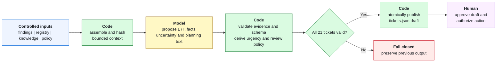

# Inspection Finding Triage

This repository turns 21 offshore inspection findings and an equipment registry
into a complete `tickets.json` draft for human approval.

The model interprets evidence and proposes likelihood, impact and planning text.
Python validates the response, derives urgency, applies escalation/review policy
and publishes the batch only when every finding is valid.

## What is included

- `tickets.json` — 21 system-generated draft tickets; no ticket was hand-written
  or hand-corrected.
- `DESIGN.md` — the architecture and direct answers to Candidate Brief A-D.
- `triage`, `triage_knowledge`, `llm_inference` — repository-owned
  orchestration, knowledge lifecycle and provider boundary.
- `docs` — the development decisions and controlled studies.
- `eval\results\README.md` — observed evidence, cost and remaining limitations.

The supplied candidate package is preserved unchanged under
`docs\candidate-pack\candidate-pack`.

## Architecture



See [`DESIGN.md`](DESIGN.md) for the responsibility boundary, assumptions,
trade-offs and failure behavior.

## Requirements

- Windows PowerShell
- Python 3.11 or later
- Git
- One inference route:
  - a GitHub Copilot subscription and native GitHub Copilot CLI; or
  - an Azure OpenAI resource, deployment, endpoint and API key

Create the environment from the repository root:

```powershell
python -m venv .venv
.\.venv\Scripts\python.exe -m pip install --upgrade pip
.\.venv\Scripts\python.exe -m pip install -e .
```

Dependencies are pinned in `pyproject.toml`.

## Option A — Run with GitHub Copilot

Install the native GitHub Copilot CLI on Windows:

```powershell
winget install GitHub.Copilot
copilot login
copilot --version
```

`copilot login` uses the browser flow by default on a local desktop. The
authenticated account needs an active Copilot subscription and access to the
selected model. Installation and authentication details are maintained in the
[GitHub Copilot CLI documentation](https://docs.github.com/en/copilot/how-tos/copilot-cli/set-up-copilot-cli/install-copilot-cli).

List the models visible to the authenticated account:

```powershell
.\.venv\Scripts\python.exe -B -m llm_inference --provider copilot --models
```

Generate `tickets.json` end to end:

```powershell
.\.venv\Scripts\python.exe -B run_triage.py --provider copilot
```

The default model is `gpt-6.1-sol`. If it is not visible to the account, select
an available model explicitly:

```powershell
.\.venv\Scripts\python.exe -B run_triage.py `
  --provider copilot `
  --model "<account-visible-model-id>" `
  --reasoning-effort "<model-supported-value>"
```

The Copilot route requires a native `copilot` executable on `PATH`. The adapter
uses the logged-in user and disables tools, MCP servers, skills, custom
instructions and host operations; it is used only as an inference transport.

## Option B — Run with Azure OpenAI

Create an Azure OpenAI resource and deploy **`gpt-6.1-sol` version
`2026-09-29`**. This matches the Copilot route's public model ID instead of
silently substituting another model family. The Azure deployment name is
arbitrary; the wrapper verifies the observed model identity after dispatch.

Set credentials in the current PowerShell session:

```powershell
$env:AZURE_OPENAI_ENDPOINT = "https://<resource>.openai.azure.com"
$env:AZURE_OPENAI_API_KEY = "<api-key>"
```

Do not write the key into a config file or commit it. The value passed to
`--model` is the **Azure deployment name**, not a public model name:

```powershell
.\.venv\Scripts\python.exe -B run_triage.py `
  --provider azure `
  --model "<azure-deployment-name>"
```

The pinned parity configuration is `gpt-6.1-sol` `2026-09-29`, medium reasoning,
an 8,192-token output cap, a 300-second provider deadline and the Azure
chat-completions API. The adapter verifies the deployment's observed model,
disables SDK retries and preserves the application attempt budget. This is the
strictly provider-SDK route; it does not use the Copilot CLI runtime. Copilot
does not expose its backend version, so matching the public model ID and request
payload does not imply byte-identical provider behavior.

## Run behavior

Each command above:

1. creates fresh configuration, evidence and attempt-ledger paths under
   `.runs`;
2. reads the unchanged supplied findings and registry;
3. loads the immutable reviewed knowledge release and the retained replay
   activation;
4. generates all 21 tickets;
5. validates identity, schema, evidence, coverage and policy; and
6. atomically replaces `tickets.json` only after the complete batch passes.

The default output is the root `tickets.json`; copy the submitted artifact first
or pass `--output <path>` if the replay must not replace it.

The command fails nonzero and preserves the previous output when any ticket
cannot be supported. A successful file is still a draft requiring human
approval. Model behavior can vary, so a replay is not expected to reproduce the
submitted file byte for byte.

The submitted root artifact was produced by the retained reviewed delivery and
promoted byte-identically. The workflow now included in this submission was
subsequently replayed successfully on all 21 findings. That observation was
recorded from a dirty worktree, so it is behavior evidence rather than a
clean-checkout reproduction; provenance and the remaining limitation are
recorded in `eval\results\README.md`.

The replay invoked the same `triage` CLI and retained source/activation in
`copilot_experiment` mode. `run_triage.py` is the documented convenience
wrapper for fresh paths and delivery-mode configuration. Its deterministic
behavior is covered by tests; each live invocation records separate run
evidence because provider output can vary.

The retained Copilot delivery used 21 application sends, completed in about ten
minutes and reprices to approximately US$2.35 at the documented API-equivalent
rates. Actual Copilot subscription allocation is not exposed. See
`docs\04_INFERENCE_LIBRARY.md` and `eval\results\delivery-cost-summary.json`.

## Verify the repository

```powershell
.\.venv\Scripts\python.exe -B -m unittest discover -s tests -p "test_*.py"
.\.venv\Scripts\python.exe -B -m unittest discover -s eval\tests -p "test_*.py"
.\.venv\Scripts\python.exe -B -m eval.validate
```

These commands verify software and artifact integrity; they do not replace
engineering or human approval of the generated tickets.

## Review path

1. [`DESIGN.md`](DESIGN.md) — architecture and Candidate Brief A-D.
2. [`tickets.json`](tickets.json) — generated deliverable.
3. [`docs\07_KNOWLEDGE_CHANGE_STUDY.md`](docs/07_KNOWLEDGE_CHANGE_STUDY.md) —
   how a future PSV knowledge change is made and evaluated.
4. [`docs\08_BEHAVIOR_CALIBRATION_STUDY.md`](docs/08_BEHAVIOR_CALIBRATION_STUDY.md)
   — before/after ticket behavior and calibration limits.
5. [`eval\results\README.md`](eval/results/README.md) — retained evidence and
   unresolved gates.

[`docs\README.md`](docs/README.md) provides the complete development chronology.

## Repository map

| Path | Purpose |
|---|---|
| `triage` | Assessment orchestration, validation, urgency and publication |
| `triage_knowledge` / `knowledge\source-first` | Source review, immutable releases, activation and context |
| `llm_inference` | Restricted Copilot and Azure inference adapters |
| `config` | Retained replay activation and run configurations |
| `tests` | Production behavior tests |
| `eval` | Frozen evaluation contract and observed evidence |
| `docs` | Design decisions, experiments and candidate package |

No high-level orchestration framework is used. Core orchestration, repair,
validation, urgency and publication logic are implemented in this repository.
