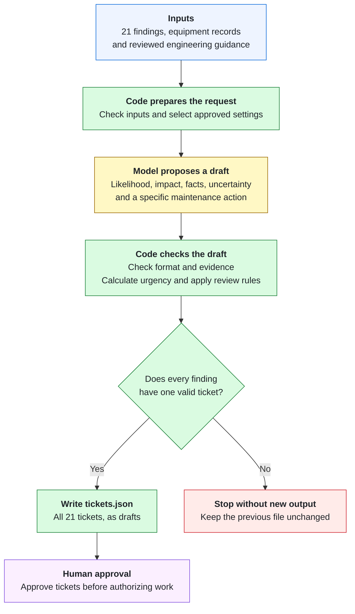

# Inspection Finding Triage

This repository turns 21 offshore inspection findings and an equipment registry
into a complete `tickets.json` draft for human approval.

The model reads the inspection evidence and proposes likelihood, impact and
planning text. Likelihood means how likely the equipment is to fail soon.
Impact means what happens if it fails.

Python checks the response, calculates urgency and applies the review rules.
It writes the output only when all findings have valid tickets. Every ticket
is a draft: a human must approve it before any work is authorized.

## What is included

- `tickets.json` — 21 system-generated draft tickets; no ticket was hand-written
  or hand-corrected.
- `DESIGN.md` — the architecture and direct answers to Candidate Brief A-D.
- `triage`, `triage_knowledge`, `llm_inference` — code for coordinating
  assessment, maintaining knowledge and sending model requests.
- `docs` — design decisions and experiments that test specific changes.
- `eval\results\README.md` — recorded results, cost and unresolved checks.

The supplied candidate package is preserved unchanged under
`docs\candidate-pack\candidate-pack`.

## Architecture



See [`DESIGN.md`](DESIGN.md) for what the model, code and human each decide,
why the design was chosen and what happens when a run fails.

## Requirements

- Windows PowerShell
- Python 3.11 or later
- Git
- One inference route:
  - a GitHub Copilot subscription and native GitHub Copilot CLI; or
  - an Azure OpenAI resource, deployment, endpoint and API key

Create the environment from the repository root:

```powershell
python -m venv .venv
.\.venv\Scripts\python.exe -m pip install --upgrade pip
.\.venv\Scripts\python.exe -m pip install -e .
```

Exact dependency versions are listed in `pyproject.toml`.

## Option A — Run with GitHub Copilot

Install the native GitHub Copilot CLI on Windows:

```powershell
winget install GitHub.Copilot
copilot login
copilot --version
```

`copilot login` uses the browser flow by default on a local desktop. The
authenticated account needs an active Copilot subscription and access to the
selected model. Installation and authentication details are maintained in the
[GitHub Copilot CLI documentation](https://docs.github.com/en/copilot/how-tos/copilot-cli/set-up-copilot-cli/install-copilot-cli).

List the models visible to the authenticated account:

```powershell
.\.venv\Scripts\python.exe -B -m llm_inference --provider copilot --models
```

Generate `tickets.json` end to end:

```powershell
.\.venv\Scripts\python.exe -B run_triage.py --provider copilot
```

The default model is `gpt-6.1-sol`. If it is not visible to the account, select
an available model explicitly:

```powershell
.\.venv\Scripts\python.exe -B run_triage.py `
  --provider copilot `
  --model "<account-visible-model-id>" `
  --reasoning-effort "<model-supported-value>"
```

The Copilot route requires a native `copilot` executable on `PATH`. The adapter
uses the logged-in account. It disables tools, MCP servers, skills, custom
instructions and host operations. Copilot only sends model requests here; it
cannot run commands or edit files during ticket generation.

## Option B — Run with Azure OpenAI

Create an Azure OpenAI resource and deploy **`gpt-6.1-sol` version
`2026-09-29`**. This matches the Copilot route's public model ID instead of
silently substituting another model family. The Azure deployment name is
your choice. After sending a request, the wrapper checks which model the
deployment actually reports.

Set credentials in the current PowerShell session:

```powershell
$env:AZURE_OPENAI_ENDPOINT = "https://<resource>.openai.azure.com"
$env:AZURE_OPENAI_API_KEY = "<api-key>"
```

Do not write the key into a config file or commit it. The value passed to
`--model` is the **Azure deployment name**, not a public model name:

```powershell
.\.venv\Scripts\python.exe -B run_triage.py `
  --provider azure `
  --model "<azure-deployment-name>"
```

## Run behavior

Each command above:

1. creates new configuration files, evidence files and an attempt log under
   `.runs`;
2. reads the unchanged supplied findings and registry;
3. loads the reviewed knowledge release, which cannot be edited after release,
   and its recorded approval for runtime use;
4. generates all 21 tickets;
5. validates identity, schema, evidence, coverage and policy; and
6. replaces `tickets.json` in one file operation, only after the complete batch
   passes. It never writes a partial batch to that path.

The default output is the root `tickets.json`; copy the submitted artifact first
or pass `--output <path>` if the replay must not replace it.

The command fails nonzero and preserves the previous output when any ticket
cannot be supported. A successful file is still a draft requiring human
approval. Model behavior can vary, so a replay is not expected to reproduce the
submitted file byte for byte.

The submitted `tickets.json` is an unchanged copy of the reviewed delivery
output. A later run using an earlier execution-policy revision also completed
all 21 findings. Tests and a separate Azure run then checked the changes for
supporting both providers. Those later runs do not replace the review of the
submitted tickets' meaning. Exact versions and limitations are recorded in
`eval\results\README.md`.

The later Copilot run used the same `triage` CLI, the saved source and the saved
runtime approval in `copilot_experiment` mode. `run_triage.py` is a convenience
wrapper: it creates new paths and selects delivery-mode configuration. Tests
cover this setup behavior. Each live run records its own evidence because the
model can produce different answers.

The recorded Copilot delivery sent 21 model requests and took about ten minutes.
Applying the documented API prices to its token usage gives an estimate of
about US$2.35. This is a price comparison, not a Copilot bill: Copilot does not
report how much of the subscription cost belongs to this run. See
`docs\04_INFERENCE_LIBRARY.md` and `eval\results\delivery-cost-summary.json`.

## Verify the repository

```powershell
.\.venv\Scripts\python.exe -B -m unittest discover -s tests -p "test_*.py"
.\.venv\Scripts\python.exe -B -m unittest discover -s eval\tests -p "test_*.py"
.\.venv\Scripts\python.exe -B -m eval.validate
```

These commands check the software and the consistency of recorded files.
Passing them does not prove that the engineering judgments are correct.
The generated tickets still need human approval.

## Review path

1. [`DESIGN.md`](DESIGN.md) — architecture and Candidate Brief A-D.
2. [`tickets.json`](tickets.json) — generated deliverable.
3. [`docs\07_KNOWLEDGE_CHANGE_STUDY.md`](docs/07_KNOWLEDGE_CHANGE_STUDY.md) —
   how a future PSV knowledge change is made and evaluated.
4. [`docs\08_BEHAVIOR_CALIBRATION_STUDY.md`](docs/08_BEHAVIOR_CALIBRATION_STUDY.md)
   — how ticket behavior changed, why it changed and what remains uncertain.
5. [`eval\results\README.md`](eval/results/README.md) — recorded evidence and
   checks that remain unresolved.

[`docs\README.md`](docs/README.md) explains the development steps and links to
the detailed documents.

## Repository map

| Path | Purpose |
|---|---|
| `triage` | Coordinates assessment, checks responses, calculates urgency and writes output |
| `triage_knowledge` / `knowledge\source-first` | Reviews sources, creates fixed releases and approves which knowledge reaches the model |
| `llm_inference` | Sends restricted model requests through Copilot or Azure |
| `config` | Saved runtime approvals and run settings |
| `tests` | Production behavior tests |
| `eval` | Frozen evaluation contract and observed evidence |
| `docs` | Design decisions, experiments and candidate package |

No high-level AI orchestration framework is used. This repository implements
the code that coordinates requests, repairs invalid responses, checks tickets,
calculates urgency and writes the final file.
